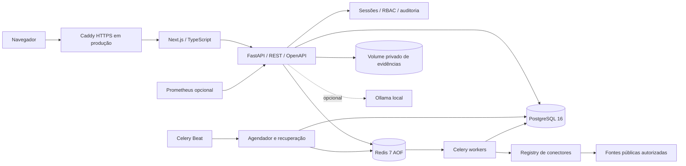
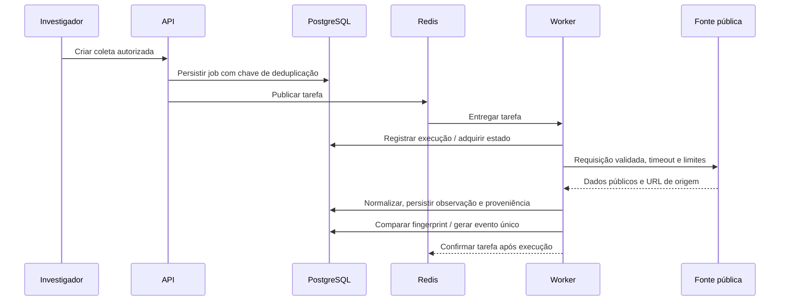

# Arquitetura

O projeto começa como monólito modular. HTTP, autorização, persistência e contratos permanecem no pacote Python `app`; worker e Beat executam a mesma versão da aplicação em processos separados. O frontend se comunica por rotas da mesma origem, evitando expor o banco ou criar uma segunda política de sessão.

## Responsabilidades

- `apps/api/app`: configurações, modelos relacionais, REST, auth, conectores, coleta, monitoramento, correlação, evidências, IA, inteligência e relatórios.
- `apps/web`: Next.js, TypeScript strict, componentes e tradução preparada para outros idiomas.
- `migrations`: esquema versionado pelo Alembic.
- `infrastructure`: TLS, observabilidade e Docker.
- `scripts`: instalação, demonstração pública, backup e restauração.
- `docs`: matriz de implementação e registros de validação.

Não se promete entrega exatamente uma vez da fila. PostgreSQL guarda estado e chaves de unicidade para limitar efeitos duplicados; recuperação reenfileira jobs pendentes. Um único processo Beat deve executar por implantação. Redis usa AOF e `noeviction`: falta de capacidade causa erro explícito, em vez de eliminar tarefas silenciosamente.

## Limites e evolução

Paginação e limites de registros/grafo reduzem pressão de memória. Coletas externas ficam fora do processo HTTP. URLs não confiáveis passam por validação de destino público; respostas normalizadas são dados, nunca instruções de IA. O filesystem de evidências é privado e compartilhado somente com os processos que precisam dele. A abstração de armazenamento deve permitir S3 self-hosted no futuro; a implantação padrão usa volume local.

Antes de ampliar concorrência, meça latência da fonte, limites oficiais, conexões PostgreSQL e tamanho das filas. Não há benchmark de escala industrial incluído; consulte [ROADMAP.md](ROADMAP.md).
