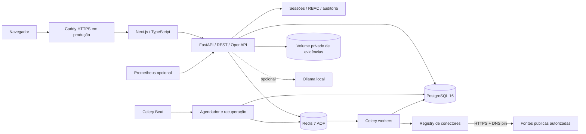

# Arquitetura

O projeto é um **monólito modular**. HTTP, autorização, persistência e contratos residem no pacote Python `app`; worker e Beat executam a mesma versão da aplicação em processos separados. O frontend se comunica por rotas da mesma origem, evitando expor o banco diretamente ou criar uma segunda política de sessão.

## Visão geral dos componentes



## Responsabilidades dos módulos

| Módulo / diretório | Responsabilidade |
|---|---|
| `apps/api/app/auth.py` | Sessões opacas, Argon2id, CSRF, RBAC, criptografia de conectores |
| `apps/api/app/collection.py` | Jobs Celery com deduplicação, ingestão de observações e fingerprint |
| `apps/api/app/monitoring.py` | Monitores recorrentes (intervalo ou cron UTC), recuperação de jobs perdidos |
| `apps/api/app/connectors/` | Implementações de fontes; `security.py` com `PublicNetworkBackend` DNS-pinned |
| `apps/api/app/correlation.py` | Sugestões automáticas de vínculos entre entidades (somente dados normalizados) |
| `apps/api/app/evidence.py` | Armazenamento privado com chaves opacas, `O_EXCL`, `O_NOFOLLOW` e SHA-256 |
| `apps/api/app/intelligence.py` | Normalização e validação de indicadores defensivos |
| `apps/api/app/reporting.py` | Exportação JSON/CSV/Markdown com escape de fórmulas CSV e blocos JSON para Markdown |
| `apps/api/app/ai.py` | Resumo extrativo e hipóteses com citações; Ollama local opcional; sem mutações |
| `apps/api/app/notifications.py` | SMTP e webhook HMAC SHA-256 com DNS pin; validação de endereço de e-mail |
| `apps/api/app/observability.py` | Logging JSON estruturado; `X-Request-ID` sanitizado |
| `apps/api/app/main.py` | Composição de middlewares: `TrustedHost`, `_RealIPMiddleware`, `CORS`, logging |
| `apps/web/` | Next.js, TypeScript strict, componentes e internacionalização |
| `migrations/` | Esquema versionado pelo Alembic; `upgrade`/`downgrade` reproduzíveis |
| `infrastructure/` | Caddy (TLS, bloqueio de métricas), Prometheus |
| `scripts/` | Instalação, demonstração pública, backup/restauração consistentes |
| `docs/` | Matriz de implementação e registros de validação |

## Fluxo de coleta

```mermaid
sequenceDiagram
  participant U as Investigador
  participant A as API
  participant P as PostgreSQL
  participant R as Redis
  participant W as Worker
  participant S as Fonte pública

  U->>A: POST /jobs (connector_id, query, config)
  A->>A: Validação RBAC + escopo da investigação
  A->>A: validate_collection() — query, config, segredos bloqueados
  A->>P: Persistir job com idempotency_key
  A->>R: Publicar tarefa (outbox transacional)
  R->>W: Entregar tarefa
  W->>P: Adquirir lock da linha (FOR UPDATE)
  W->>S: HTTPS + DNS pin, timeout 20s, max 2 MB
  S-->>W: Dados públicos e URL de origem
  W->>P: Comparar fingerprint; persistir observação se nova/alterada
  W->>P: Gerar alerta de mudança se monitor configurado
  W->>P: Atualizar status do job e saúde do conector
  W-->>R: Confirmar tarefa (acks_late)
```

## Garantias de consistência

- **Sem entrega exatamente uma vez.** PostgreSQL guarda o estado e chaves de unicidade (`fingerprint`) para limitar efeitos de entregas duplicadas.
- **Deduplicação por fingerprint.** Observações com mesmo `external_id` e dados canônicos idênticos são ignoradas; regressões A→B→A permanecem visíveis.
- **Cancelamento durável.** O status do job no banco controla a execução; workers verificam antes de ingerir resultados, mesmo que a mensagem da fila já tenha sido entregue.
- **Outbox transacional.** A publicação na fila e a atualização do status do job são atômicas; falha do broker deixa o job em `pending` para a próxima varredura do Beat.
- **Um Beat por implantação.** Múltiplos processos Beat causam jobs duplicados; use a lock do próprio Celery Beat ou controle pelo orquestrador.

## Proteção SSRF

Todos os conectores e o webhook de alertas usam `PublicNetworkBackend`:

1. `validate_public_url()` — rejeita esquemas não-HTTPS, credenciais na URL, porta ≠ 443, loopback, RFC-1918, `.local`, `.internal`, Teredo e 6to4.
2. `resolve_public_addresses()` — resolve DNS e verifica que **todos** os endereços são públicos.
3. `PublicNetworkBackend.connect_tcp()` — conecta ao endereço numérico resolvido (DNS pin), impedindo rebinding após a validação.

A exceção são os hosts em `OFFICIAL_HOSTS` quando `HTTPS_PROXY` está definido no ambiente — o proxy de deploy é infraestrutura confiável de operação, não input do usuário.

## Limites e evolução

- Paginação e limites de registros/grafo reduzem pressão de memória (`node_limit` ≤ 500, `edge_limit` ≤ 2000).
- Coletas externas ficam fora do processo HTTP (Celery worker isolado).
- Correlação automática é sugestão — confirmação exige revisão humana com justificativa explícita.
- A abstração de armazenamento de evidências suporta S3/MinIO além do volume local.
- Antes de ampliar concorrência, meça latência da fonte, limites oficiais, conexões PostgreSQL e tamanho das filas.

Veja [ROADMAP.md](ROADMAP.md) para próximas evoluções planejadas.
