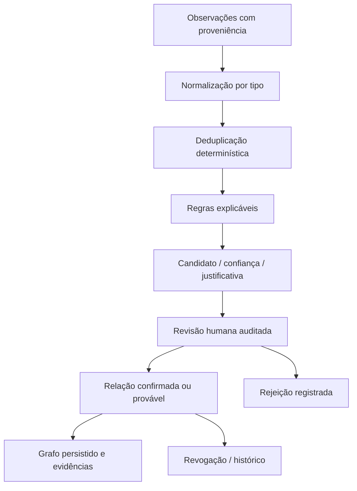

# Resolução de entidades e correlação

Normalização trata tipos explicitamente: domínio/IDNA, IP canônico e identificadores de plataforma. Um username não é uma identidade universal. Pessoas, organizações, perfis sociais, domínios, IPs, repositórios, documentos, indicadores e evidências permanecem entidades distintas.

O motor registra score e razões da sugestão, diferenciando fatos observados, possíveis relações e hipóteses. Scores indicam prioridade para revisão; não são probabilidades estatisticamente calibradas. Semelhança de nome, imagem ou descrição não confirma que perfis pertencem à mesma pessoa. Similaridade não causa merge irreversível.

A revisão registra autor, decisão, instante e referências às evidências. Relações confirmadas, prováveis e não verificadas têm estados explícitos. Revogar uma relação preserva o histórico auditável. O grafo lê relações persistidas com limites por investigação; não inventa arestas para preencher o layout.

Teste regras determinísticas, aliases, normalização, falsos positivos, estados de revisão, repetição idempotente e isolamento entre investigações. Referências ao registro de origem devem estar disponíveis ao investigador antes da confirmação.
