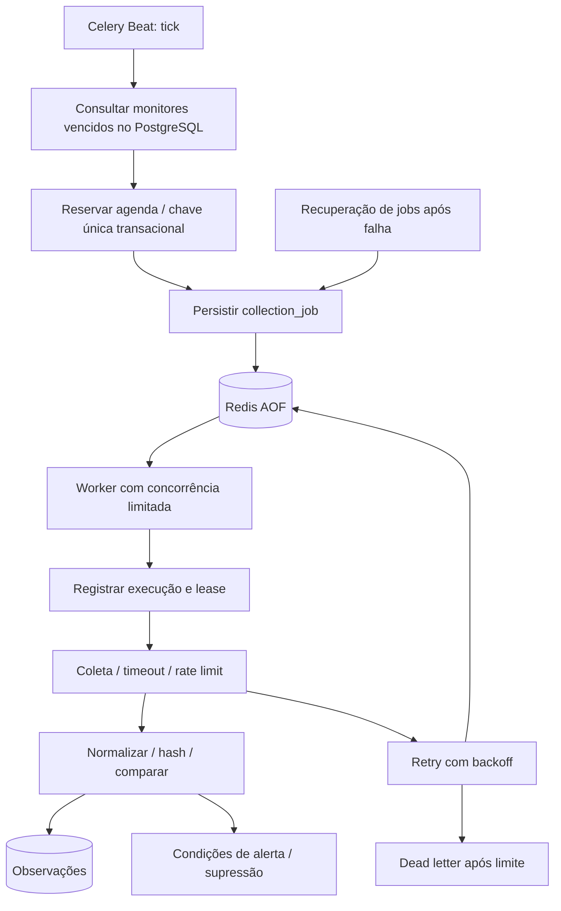

# Monitoramento contínuo

Monitores guardam investigação, conector, consulta, configuração, prioridade e agenda. Intervalos e cron são executados em UTC. Pausar um monitor impede novas execuções; trabalhos já em andamento dependem de cancelamento cooperativo.



Execute exatamente um Beat por stack. A fila usa Redis persistente, mas jobs e execuções ficam no PostgreSQL. A recuperação deve tratar tarefas persistidas não publicadas ou leases vencidas sem duplicar efeitos. `acks_late` por si só não garante idempotência; unicidade e transações limitam reprocessamento.

Alertas podem ser entregues internamente, por SMTP ou por webhook HMAC configurado por ambiente. A entrega manual autenticada está disponível em `POST /api/v1/alerts/{id}/deliver`. Evidências vencidas podem ser removidas pelo job operacional `make purge`; faça backup antes de uma política agressiva de expurgo.

```bash
docker compose logs --tail=100 beat worker
docker compose exec worker celery -A app.celery_app:celery_app inspect ping
docker compose restart worker beat
```

Um monitor com fonte estável pode executar corretamente sem detectar mudança. Primeira coleta gera nova observação; revisitas idênticas não devem produzir alerta duplicado. Alteração deve manter as duas observações e apontar o dado anterior. Erros persistentes exigem alerta operacional, sem produzir dados de fonte simulados.

`WORKER_CONCURRENCY` limita processos e deve ser compatível com quotas remotas. Redis `noeviction` permite backpressure explícito quando a memória acaba. Reinícios de Beat recalculam monitores a partir do banco; o arquivo Beat é operacional e fica em `/tmp`.

Relatórios e documentação não devem assumir escalabilidade validada sem benchmark. A matriz registra quais cenários de concorrência, retries, recuperação e cron foram efetivamente testados.
